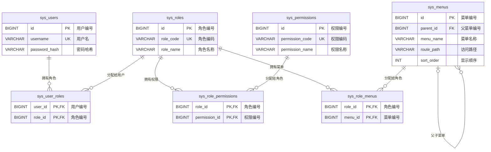

# MySQL 数据库 ER 图

当前聊天室数据库包含用户、角色、权限、菜单和三张多对多关系表。

## 关系说明

- 一个用户可以拥有多个角色，一个角色也可以分配给多个用户。
- 一个角色可以拥有多个权限，一个权限也可以分配给多个角色。
- 一个角色可以看到多个菜单，一个菜单也可以分配给多个角色。
- `sys_menus.parent_id` 用于表示菜单层级，顶级菜单的 `parent_id` 为 `NULL`。
- `sys_user_roles`、`sys_role_permissions`、`sys_role_menus` 使用联合主键，防止同一关系重复写入。
