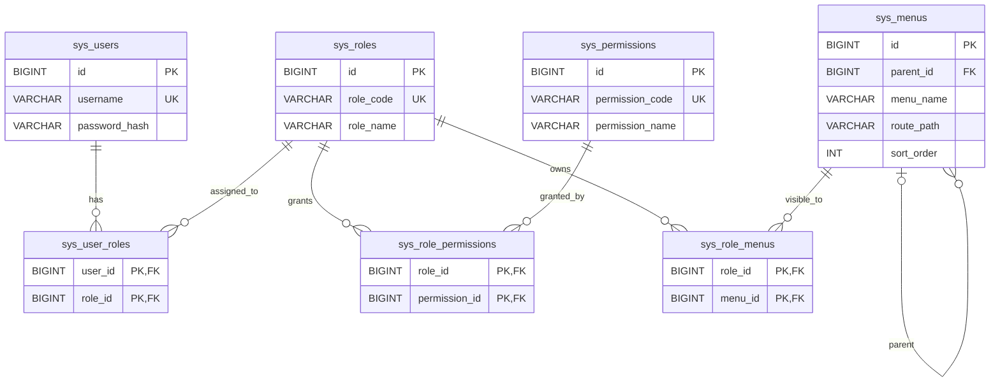

# 用户 + 权限系统最简表设计

## ER 图

## 表职责

用户表保存唯一用户名和密码哈希；角色表保存编码和显示名称；权限表保存权限编码和显示名称。菜单表保存名称、父菜单、路径和排序。三张关联表分别表示用户角色、角色权限和角色可见菜单，使用联合主键避免重复分配。

菜单包含首页、系统设置、大屏、消息通知，以及系统设置下的用户管理、角色管理、权限管理、菜单管理。顶层菜单的 parent_id 为 NULL，目录菜单的 route_path 为 NULL。

删除状态、昵称、登录时间、创建/更新时间、分配时间、描述、图标、组件路径及权限的菜单/API 元数据。基础版本不提供禁用功能。菜单可见性不能代替后端权限校验。

## 项目落地

首次登录自动注册用户并分配 member 角色，再次登录校验密码哈希。默认 admin 拥有全部种子菜单和权限，member 拥有首页和消息通知。当前实现账号持久化及权限系统表设计；管理接口、页面和后端权限校验尚未实现。

Docker Compose 编排 MySQL、Go 服务端和客户端，通过 mysql_data 数据卷保存数据库数据。启动方式见 [docker_compose.md](docker_compose.md)，建表 SQL 见 [schema.sql](../sql/schema.sql)。

## 已有数据库升级

auto_migrate 只创建不存在的表，不删除旧字段。已有原版数据库先备份，停止服务端写入，再执行 [simplify_schema.sql](../sql/simplify_schema.sql)，然后重新构建并启动服务端。该脚本只适用于原版七张表，执行一次；保留账号、密码哈希和关联关系，删除辅助字段的数据。

